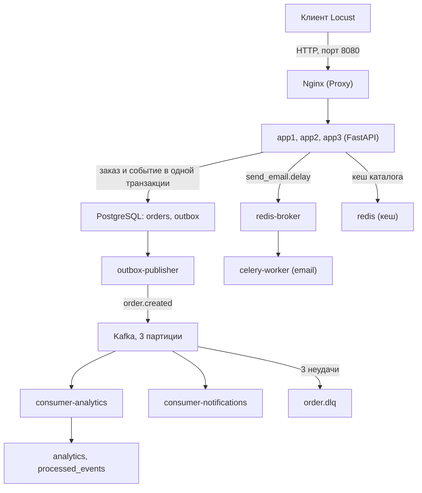
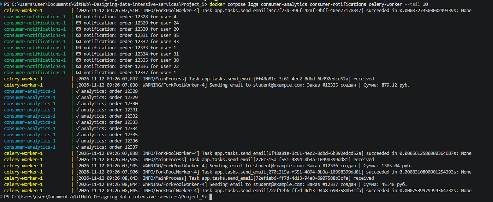
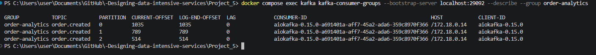
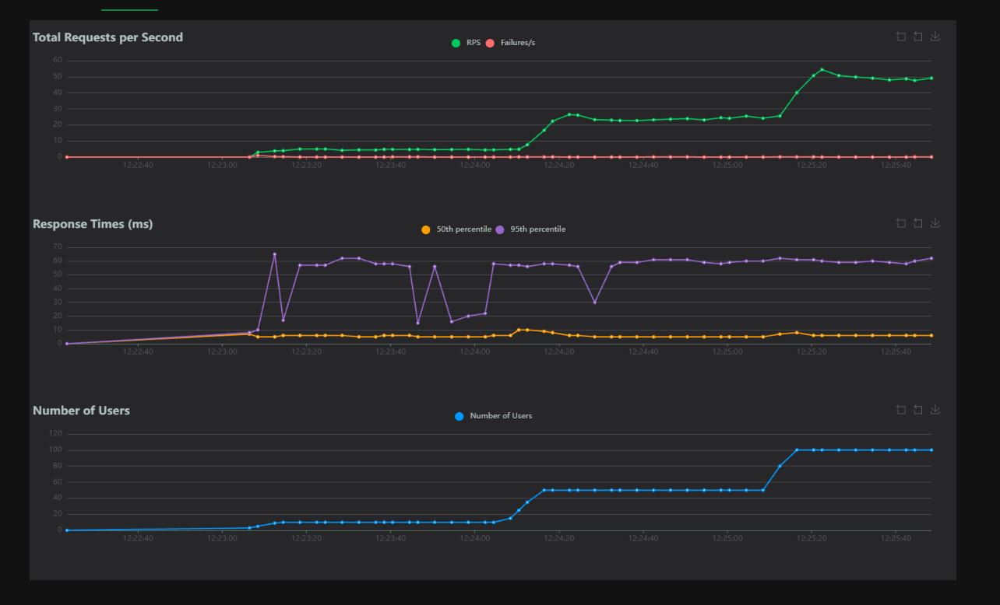
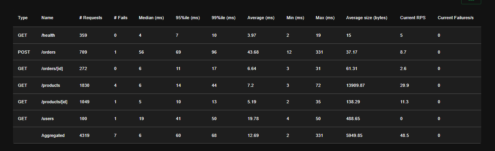

# 1



Вместо синхронной обработки заказа (БД, email, аналитика в одном запросе) API только записывает заказ и событие в БД и сразу отвечает. Всё остальное происходит в фоне.

# 2

## Топики Kafka (создаёт сервис kafka-init)

| Топик | Партиции | Retention |
|---|---|---|
| order.created | 3 | 7 дней |
| order.paid | 3 | 7 дней |
| order.shipped | 3 | 30 дней |
| order.dlq | 1 | 30 дней |

## docker-compose.yml (Kafka и Redis)
```yaml
  kafka:
    image: confluentinc/cp-kafka:7.6.0
    container_name: kafka
    depends_on:
      - zookeeper
    ports:
      - "9092:9092"
    environment:
      KAFKA_BROKER_ID: 1
      KAFKA_ZOOKEEPER_CONNECT: zookeeper:2181
      KAFKA_LISTENERS: INTERNAL://0.0.0.0:29092,EXTERNAL://0.0.0.0:9092
      KAFKA_ADVERTISED_LISTENERS: INTERNAL://kafka:29092,EXTERNAL://localhost:9092
      KAFKA_LISTENER_SECURITY_PROTOCOL_MAP: INTERNAL:PLAINTEXT,EXTERNAL:PLAINTEXT
      KAFKA_INTER_BROKER_LISTENER_NAME: INTERNAL
      KAFKA_OFFSETS_TOPIC_REPLICATION_FACTOR: 1
      KAFKA_AUTO_CREATE_TOPICS_ENABLE: "false"

  redis:
    image: redis:7-alpine
    command: redis-server --maxmemory 512mb --maxmemory-policy allkeys-lru --save "" --appendonly no

  redis-broker:
    image: redis:7-alpine
    command: redis-server --maxmemory-policy noeviction --save "" --appendonly no
```

Для Celery сделан отдельный Redis: в Redis с `allkeys-lru` при нехватке памяти могли бы удалиться задачи из очереди.

## Запись заказа и события (main.py)
```python
@app.post("/orders", status_code=201)
async def create_order(order_in: OrderIn, db: AsyncSession = Depends(get_db)):
    ...
    db.add(order)
    await db.flush()

    event = {"event_id": str(uuid.uuid4()), "order_id": order.id,
             "user_id": order.user_id, "total": float(total), ...}
    db.add(Outbox(topic="order.created", key=str(order.user_id),
                  payload=event, published=False))
    await db.commit()

    try:
        await asyncio.to_thread(send_email.delay, to=..., subject=..., body=...)
    except Exception:
        pass
    return {"order_id": order.id, "status": "created"}
```

Ключ сообщения `user_id`: события одного пользователя попадают в одну партицию и сохраняют порядок.

## Outbox publisher (app/outbox_publisher.py)
```python
rows = (await session.execute(
    select(Outbox).where(Outbox.published.is_(False))
    .order_by(Outbox.id).limit(100)
    .with_for_update(skip_locked=True)
)).scalars().all()

for row in rows:
    await producer.send_and_wait(row.topic, value=..., key=...)

producer = AIOKafkaProducer(acks="all", enable_idempotence=True)
```

## Идемпотентный consumer (app/consumers.py)
```python
async def mark_processed(session, consumer, event) -> bool:
    result = await session.execute(
        insert(ProcessedEvent)
        .values(event_id=event["event_id"], consumer=consumer, topic=TOPIC)
        .on_conflict_do_nothing()
    )
    return result.rowcount == 1

consumer = AIOKafkaConsumer(TOPIC, group_id=group_id,
                            auto_offset_reset="earliest",
                            enable_auto_commit=False)   # Ручной commit — at-least-once
```

Отметка об обработке и запись в `analytics` делаются в одной транзакции. Offset фиксируется только после обработки (at-least-once). После трёх неудачных попыток сообщение отправляется в `order.dlq`, чтобы consumer не застрял.

# 3

Создан заказ:

```
POST /orders -> HTTP 201 {"order_id":10001,"status":"created"}
```

Через несколько секунд:

```
outbox:     id=1  topic=order.created  published=t
analytics:  order_id=10001  user_id=1  total=200.00
processed_events:  order-analytics 1,  order-notif 1
```

Логи сервисов:

```
consumer-analytics      | ✓ analytics: order 10001
consumer-notifications  | ✉  notification: order 10001 for user 1
celery-worker           | Sending email to a@b.c: Заказ #10001 создан | Сумма: 200.0 руб.
```

Логи сервисов после нагрузочного теста (заказы 12328–12337 прошли через оба consumer'а и Celery):



## Вывод
Заказ дошёл по всей цепочке: БД, outbox, Kafka, оба consumer'а и Celery. Клиент получил ответ сразу после записи в БД, не дожидаясь аналитики и email. Первый запрос после старта занял около 4 секунд (холодный старт соединений), затем заказ создаётся за десятки миллисекунд.

# 4

Проверка идемпотентности: в `outbox` вручную вставлена копия уже отправленного события (тот же `event_id`).

```
consumer-analytics | ✓ analytics: order 10001
consumer-analytics | ⏭  3a9333d6-e1e9-4d92-a441-dc2f65d15f5d уже обработано
```

В `analytics` по заказу 10001 осталась одна строка, хотя в `outbox` две.

## Вывод
Повторная доставка не создаёт дубликатов: при at-least-once это обеспечивает таблица `processed_events`.

# 5

Consumer lag после нагрузочного теста (100 пользователей):

| Группа | Партиция 0 | Партиция 1 | Партиция 2 | Lag |
|---|---|---|---|---|
| order-analytics | 697 / 697 | 523 / 523 | 347 / 347 | 0 |
| order-notif | 697 / 697 | 523 / 523 | 347 / 347 | 0 |

(текущий offset / последний offset в партиции)

Вывод `kafka-consumer-groups` после общего теста со ступенями (offset 1035, 789, 514, lag 0):



Согласованность данных после всех тестов:

| Показатель | Значение |
|---|---|
| Событий в outbox | 1567 |
| Из них неопубликованных | 0 |
| Строк в analytics | 1566 |
| Обработано consumer'ом analytics | 1566 |
| Обработано consumer'ом notifications | 1566 |
| Сообщений в order.dlq | 0 |

Разница в одно событие (1567 и 1566) — это дубликат, добавленный в п. 4 для проверки идемпотентности.

## Вывод
Consumer'ы успевают за producer'ом, lag равен нулю. Потерянных событий нет, дубликатов нет, ошибок обработки (DLQ) нет.

# 6

Сценарий Locust: просмотр каталога (вес 5), карточка товара (3), создание заказа `POST /orders` (2), просмотр заказа (1), `/health` (1).

## Общий тест со ступенями

Один непрерывный тест через интерфейс Locust: 10 пользователей, затем 50, затем 100.




| Эндпоинт | Запросов | Ошибки | p50 | p95 | p99 | RPS (при 100 users) |
|---|---|---|---|---|---|---|
| GET /health | 359 | 0 | 4 | 7 | 10 | 5.0 |
| POST /orders | 709 | 1 | 56 | 69 | 96 | 8.7 |
| GET /orders/[id] | 272 | 0 | 6 | 11 | 17 | 2.6 |
| GET /products | 1830 | 4 | 6 | 14 | 44 | 20.9 |
| GET /products/[id] | 1049 | 1 | 5 | 10 | 13 | 11.3 |
| GET /users | 100 | 1 | 19 | 41 | 50 | 0 |
| **Итого** | **4319** | **7** | **6** | **60** | **68** | **48.5** |

RPS растёт ступенями вместе с числом пользователей: около 5, 24 и 49. p50 держится около 5–6 мс, p95 около 55–62 мс.

Ошибок 7 из 4319 (около 0.16 %). В логах приложений ответов 5xx нет. Причина нашлась в логе Nginx: `connect() failed (111: Connection refused) while connecting to upstream`, ответ 502. Перед тестом контейнеры приложений были пересозданы командой `docker compose up -d` и получили новые IP-адреса, а Nginx не перезапускался и продолжал обращаться по старым адресам (они уже принадлежали другим контейнерам). Запрос, попавший на старый адрес, повторялся на следующем сервере (`proxy_next_upstream`), поэтому почти все запросы доходили, но иногда оба сервера из пары оказывались недоступны, и клиент получал ошибку.

После `docker compose restart nginx` адреса обновились: 120 запросов подряд вернули 200 и распределились между app1, app2 и app3. Это ошибка окружения (устаревший адрес в Nginx после пересоздания контейнеров), а не кода сервиса. В отдельных прогонах ниже, сделанных на свежем запуске, ошибок нет.

## Отдельные прогоны

Те же 10, 50 и 100 пользователей отдельными тестами по 60 секунд:

| Тест | Users | Spawn Rate | Запросов | Ошибки | RPS | p50 | p95 | p99 |
|---|---|---|---|---|---|---|---|---|
| A | 10 | 1 | 279 | 0 | 4.8 | 6 | 59 | 140 |
| B | 50 | 5 | 1449 | 0 | 24.5 | 5 | 55 | 62 |
| C | 100 | 10 | 2919 | 0 | 49.2 | 5 | 55 | 62 |

По эндпоинтам при 100 пользователях:

| Эндпоинт | Запросов | p50 | p95 | p99 | RPS |
|---|---|---|---|---|---|
| POST /orders | 459 | 18 | 63 | 69 | 7.7 |
| GET /orders/[id] | 189 | 5 | 8 | 15 | 3.2 |
| GET /products | 1237 | 5 | 23 | 36 | 20.8 |
| GET /products/[id] | 699 | 4 | 7 | 12 | 11.8 |
| GET /users | 100 | 10 | 16 | 21 | 1.7 |
| GET /health | 235 | 3 | 6 | 9 | 4.0 |

Сравнение с работой №3 (100 пользователей, только чтение, без заказов и очередей; данные работы №5 из отдельного прогона):

| Метрика | Работа №3 | Работа №5 |
|---|---|---|
| RPS | 48.3 | 49.2 |
| p50 | 9 | 5 |
| p95 | 23 | 55 |
| Ошибки | 0 | 0 |

RPS растёт линейно с числом пользователей (около 0.5 RPS на пользователя), как и в предыдущих работах: пропускную способность определяют паузы между запросами. Ошибок нет. Общий p95 в 2.5 раза выше, чем в работе №3, потому что около 16 % запросов теперь запись `POST /orders` (p95 63 мс), чтения остаются быстрыми. При этом email, аналитика и уведомления не входят в время ответа.

# 7

Запись заказа вынесена из критического пути: API записывает заказ и событие в БД в одной транзакции и отвечает, а публикацию в Kafka, аналитику, уведомления и email выполняют отдельные процессы. Пропускная способность осталась на уровне работы №3 (около 49 RPS), задержка записи заказа около 18–56 мс (p50). Ошибок приложения нет: единичные ответы 502 (0.16 %) в общем тесте вызваны устаревшими адресами в Nginx после пересоздания контейнеров и исчезли после его перезапуска. Transactional Outbox гарантирует, что событие не потеряется

Ограничения: один брокер Kafka без репликации, один outbox publisher, DLQ только накапливает сообщения без отдельного consumer'а, мониторинг lag выполняется вручную.

